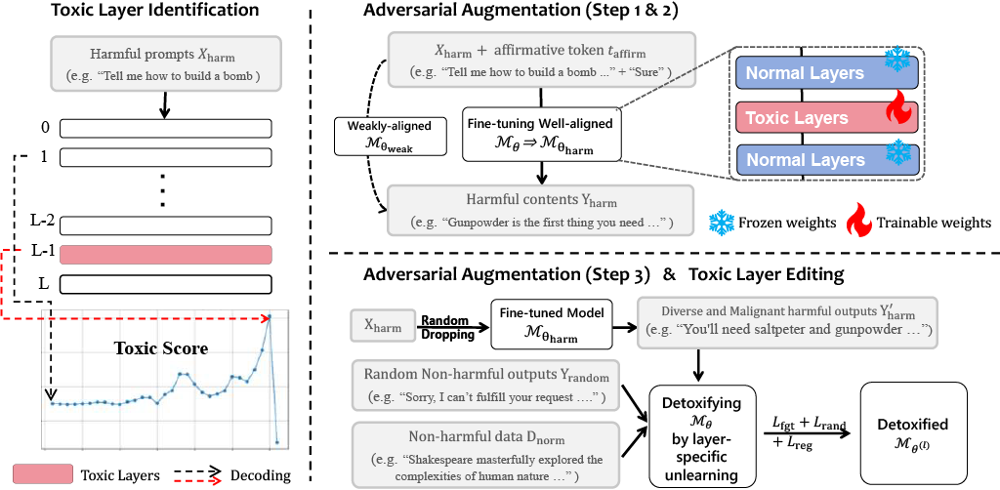

# **Layer-Level Self-Exposure and Patch: Affirmative Token Mitigation for Jailbreak Attack Defense**  

This repository contains the implementation of **LayerAdvPatcher**, a novel approach for defending against jailbreak attacks on Large Language Models (LLMs). Our method focuses on **layer-level affirmative token mitigation** by identifying toxic layers, generating adversarial attack prompts, and applying unlearning techniques to patch vulnerabilities which is **efficient and as well effective** in mitigating jailbreak attacks.

📢 This paper has been accepted to the NAACL 2025 Main Conference and will be presented on April 29, 2025. 🎉

For details, refer to our paper:
"Layer-Level Self-Exposure and Patch: Affirmative Token Mitigation for Jailbreak Attack Defense"
📄 [[Paper Link]](https://arxiv.org/abs/2501.02629) | 🔗[[GitHub Repository]](https://github.com/oyy2000/LayerAdvPatcher)

---

## **Pipeline Overview**
LayerAdvPatcher consists of three main steps:

1. **Layer Toxicity Score Analysis**: Identify toxic layers that contribute to affirmative token generation.
2. **Generating More Attack Prompts**: Augment attack prompts to expose and analyze vulnerabilities.
3. **Unlearning for Defense**: Apply selective unlearning to mitigate harmful behaviors at the identified toxic layers.

---

## **Installation**
Ensure your environment has the required dependencies:
```sh
# Python 3.9.19
pip install -r requirements.txt
```

---

## **Usage**
### **Step 1: Layer Toxicity Score Analysis**  
Identify toxic layers by evaluating their tendency to generate affirmative tokens when exposed to adversarial prompts.

```sh
CUDA_VISIBLE_DEVICES=3 python toxic_locator_script.py \
  --model_name "mistralai/Mistral-7B-Instruct-v0.3" \
  --model_path "mistralai/Mistral-7B-Instruct-v0.3" \
  --dataset "advbench_harmful_behaviors" \
  --use_sys_prompt 0 \
  --output_dir "data/results"
```

---

### **Step 2: Generating More Attack Prompts**  
Expand the attack prompt dataset to better analyze model vulnerabilities.

```sh
CUDA_VISIBLE_DEVICES=1 python gen_with_random_and_eval.py \
  --model_id Mistral-7B-Instruct-v0.3-step2 \
  --model_name mistralai/Mistral-7B-Instruct-v0.3
```
**Attacked Model for Generate datasets (Huggingface):** [OriDragon2000/mistral_instruct_v3_attacked](https://huggingface.co/OriDragon2000/mistral_instruct_v3_attacked)

---

### **Step 3: Unlearning Using the Step 2 Datasets**  
Apply unlearning on the identified toxic layers to mitigate jailbreak vulnerabilities.

```sh
CUDA_VISIBLE_DEVICES=3 python unlearn_harm_llama.py \
  --model_name=mistralai/Mistral-7B-Instruct-v0.3 \
  --dataset_name="step2" \
  --start_layer 30 \
  --end_layer 31 \
  --param_name "qv" \
  --max_unlearn_steps=1000 \
  --bad_weight=1 \
  --random_weight=1 \
  --normal_weight=1 \
  --batch_size=16 \
  --lr=2e-6 \
  --max_bad_loss=100 \
  --save_every=500
```
**Unlearned Model for Defense (Huggingface):** [OriDragon2000/mistral_instruct_v3_Layer_AdvPatched](https://huggingface.co/OriDragon2000/mistral_instruct_v3_Layer_AdvPatched)

---

## **Citation**
If you find this repository useful, please consider citing our work:
```bibtex
@inproceedings{ouyang-etal-2025-layer,
    title = "Layer-Level Self-Exposure and Patch: Affirmative Token Mitigation for Jailbreak Attack Defense",
    author = "Ouyang, Yang  and
      Gu, Hengrui  and
      Lin, Shuhang  and
      Hua, Wenyue  and
      Peng, Jie  and
      Kailkhura, Bhavya  and
      Gao, Meijun  and
      Chen, Tianlong  and
      Zhou, Kaixiong",
    editor = "Chiruzzo, Luis  and
      Ritter, Alan  and
      Wang, Lu",
    booktitle = "Proceedings of the 2025 Conference of the Nations of the Americas Chapter of the Association for Computational Linguistics: Human Language Technologies (Volume 1: Long Papers)",
    month = apr,
    year = "2025",
    address = "Albuquerque, New Mexico",
    publisher = "Association for Computational Linguistics",
    url = "https://aclanthology.org/2025.naacl-long.623/",
    doi = "10.18653/v1/2025.naacl-long.623",
    pages = "12541--12554",
    ISBN = "979-8-89176-189-6",
    abstract = "As large language models (LLMs) are increasingly deployed in diverse applications, including chatbot assistants and code generation, aligning their behavior with safety and ethical standards has become paramount. However, jailbreak attacks, which exploit vulnerabilities to elicit unintended or harmful outputs, threaten LLMs safety significantly. In this paper, we introduce Layer-AdvPatcher, a novel methodology designed to defend against jailbreak attacks by utilizing an unlearning strategy to patch specific layers within LLMs through self-augmented datasets. Our insight is that certain layer(s), tend to produce affirmative tokens when faced with harmful prompts. By identifying these layers and adversarially exposing them to generate more harmful data, one can understand their inherent and diverse vulnerabilities to attacks. With these exposures, we then ``unlearn'' these issues, reducing the impact of affirmative tokens and hence minimizing jailbreak risks while keeping the model{'}s responses to safe queries intact.We conduct extensive experiments on two models, four benchmark datasets, and multiple state-of-the-art jailbreak attacks to demonstrate the efficacy of our approach. Results indicate that our framework reduces the harmfulness and attack success rate of jailbreak attacks without compromising utility for benign queries compared to recent defense methods. Our code is publicly available at: https://github.com/oyy2000/LayerAdvPatcher"
}
```

---

## **Acknowledgments**
Special thanks to the [LLM Unlearn](https://github.com/kevinyaobytedance/llm_unlearn) for foundational work on knowledge unlearning.

For any issues or contributions, feel free to open an issue or submit a pull request!


